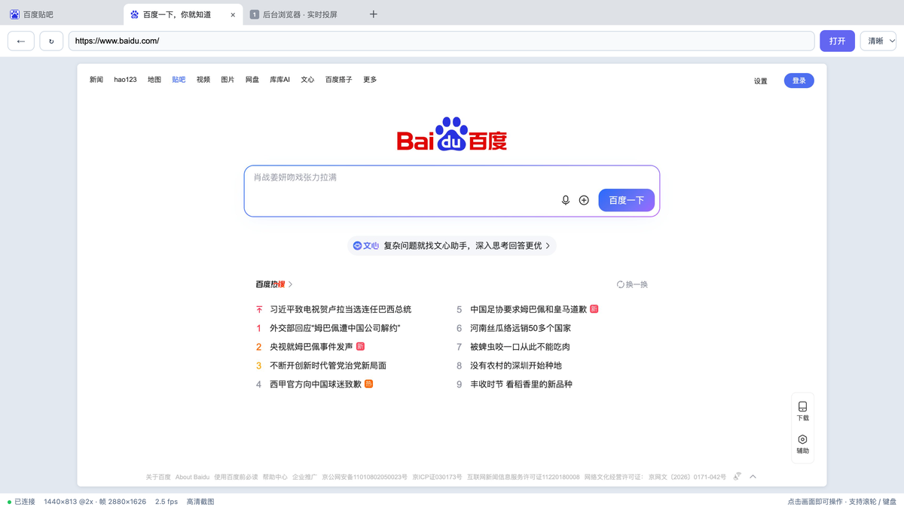

# 后台浏览器投屏控制台

在后台养一台 Chrome（**不显示窗口、不抢焦点**），把它的画面实时推到浏览器里看，并且能用鼠标直接点击 / 拖拽 / 输入 —— 相当于一台「自带显示器的远程 CDP 浏览器」。



**平台**：macOS。前置依赖两样 —— `patchright`（Python 包，提供打过反检测补丁的驱动）与本机装好的 Chrome 系浏览器。`bhost.py start` 会在启动前自检这两项，缺什么直接说清怎么装，不会只丢一段 traceback。

**约定**：下文 `$SKILL_DIR` 是**文档占位符、不是环境变量** —— 它指本 SKILL.md 所在目录（即技能根目录）。随附脚本一律用自身路径定位，不依赖安装位置与当前工作目录。

## 路由边界（先读）

| 场景 | 用什么 |
|---|---|
| 读静态页、搜资料、拿正文 | **WebFetch / curl**，不要启动本技能 |
| 要渲染 + 登录态 + 反检测，**不需要看画面** | `patchright-browser`（更省 token） |
| 要在网页里**实时看画面**、用鼠标点/拖/输入、且不抢本机焦点 | **本技能** |
| 需要多标签像桌面 Chrome 一样切来切去 | **本技能** |
| 滑块/拼图类验证码需要人眼对准再拖 | **本技能**（把画面给人，人拖） |

判断标准很简单：**这件事需不需要「看见屏幕」**。不需要就别用，本技能有编码 + 推流开销。

## 架构：两个进程，两个端口

| 端口 | 进程 | 职责 |
|---|---|---|
| `9444` | `scripts/bhost.py` | 只负责「把浏览器养着」，对外是标准 CDP 端点。宿主在，浏览器就在 |
| `9334` | `scripts/screen.py` | 投屏控制台（`/` 是页面，`/api/*` 是操作，`/stream` 是 MJPEG 帧流） |

两个进程**互不依赖**：`screen.py` 随便重启（改代码、调档位），浏览器和登录态都不动。宿主挂了控制台会自动重连。

身份：独立 `profile/` 目录，与 `patchright-browser` 的 profile 完全隔离。

**数据目录**：`profile/`、`bhost.pid`、`.last-tab-<端口>.json`、日志统一落在一个数据目录里，**默认就是技能根目录**。用 `BG_DATA=/别处的路径` 可以把它们整体挪走 —— 从技能市场安装时，代码落在带版本号的目录（`plugins/cache/<市场>/<插件>/<版本>/`），升版本会换目录；这时把 `BG_DATA` 钉在一个稳定路径，登录态才不会跟着版本一起丢。

**重置身份**：删掉数据目录下的 `profile/` 即可，下次启动是全新未登录的浏览器。

## 启动 / 停止 / 状态

```bash
# $PY = 装了 patchright 的那个解释器；$SKILL_DIR = 本技能目录
$PY "$SKILL_DIR/scripts/bhost.py" start --url https://www.baidu.com/

# 2) 启动控制台（另一个后台任务）
cd "$SKILL_DIR/scripts" && BG_CDP=http://127.0.0.1:9444 BG_PORT=9334 $PY screen.py

# 状态 / 停止
$PY "$SKILL_DIR/scripts/bhost.py" status
$PY "$SKILL_DIR/scripts/bhost.py" stop
```

启动参数：

- `--dpr 2`（默认）：按 Retina 栅格化，投屏不糊的**根本原因**，别改回 1
- `--headed`：有头但离屏。顽固风控站用，渲染管线与真机一致（此模式 dpr 由系统决定，`--dpr` 不生效）
- `--no-fix-screen`：关掉 screen/dpr 对齐，仅排查用
- `--port` / `--profile`：换 CDP 端口 / 换身份目录（要并行跑第二台浏览器时用）
- `--url`：初始页面

控制台端口用环境变量 `BG_PORT`（默认 9334）、上游 CDP 用 `BG_CDP`。9334 被占时换一个即可，两个实例互不影响（标签记忆按端口分文件存）。

**浏览器随会话结束而停止**。要开机常驻 + 崩溃拉起，跑一次 `install.sh`（见「常驻安装」）。

## 控制台怎么用（给人看的那部分）

- 顶部**横向标签栏**：点标签切换、`＋` 新建、`×` 关闭；重启后自动回到上次那个标签
- 地址栏：输入网址或 `127.0.0.1:3000` 回车即开
- 右上 **清晰度下拉**：清晰 / 均衡 / 省流，实时切换，不用重启浏览器
- 底部状态栏：`1440×813 @2x · 帧 2880×1626 · 2.5 fps · 高清截图` —— 左边是 CSS 视口、右边是帧的真实像素
- 画面里**按住拖拽**就是真拖拽（滑块验证码直接拖）

## AI 操作 API（一律 `curl -s -X POST -d '{...}'`）

```bash
UI=http://127.0.0.1:9334
curl -s -X POST -d '{}' $UI/api/state          # 状态 + 标签列表（唯一必查的接口）
```

| route | body | 说明 |
|---|---|---|
| `state` | `{}` | 返回 `url/w/h/dpr/fw/fh/gear/cast/fps/idx/tid/pages` |
| `goto` | `{"url":"..."}` | 不写协议自动补 `http://` |
| `reload` / `back` | `{}` | |
| `tab` | `{"id":"<targetId>"}` 或 `{"index":1}` | 切标签，**认 id 不认下标**（关中间标签后下标会前移） |
| `new` / `close` | `{}` / `{"id"}` | 最后一个标签不关 |
| `mouse` | `{"type":"down","x":..,"y":..}` | 按下；`move` 支持 `{"pts":[{x,y},...],"held":true}` 批量；`up` 松开 |
| `click` | `{"x":..,"y":..}` | 单次点击（按下+松开） |
| `wheel` | `{"dx":0,"dy":300}` | 滚轮，坐标默认视口中心 |
| `text` | `{"text":"..."}` | 插入文本（走 IME 路径，中文可用） |
| `key` | `{"vk":13,"key":"Enter","code":"Enter"}` | 单个按键 |
| `gear` | `{"gear":"clear"}` | 切清晰度档位 |

帧流：`curl -s $UI/stream` 是 `multipart/x-mixed-replace`，一帧一个 JPEG，静止时不出帧。

省 token 读法：

```bash
curl -s -X POST -d '{}' $UI/api/state | python3 -c \
  "import sys,json;d=json.load(sys.stdin);print({k:d[k] for k in ('url','w','h','gear','fps')})"
```

## 给用户看画面

用 `present_files` 打开 `http://127.0.0.1:9334`（内置预览面板），**不要**截图贴 Markdown —— 用户要的是能直接拖的活画面。用户说「看不到/白屏」时先确认 9334 在监听，再让他刷新预览。

## 三个常见配方

**① 登录一次，长期复用**（最常用）

```bash
$PY $SKILL/scripts/bhost.py start --url https://目标站/login
# 用户在 9334 手动登录（账号密码或扫码），登录态落进 profile/，之后不用再登
```

**② 看一个本机开发页**

```bash
$PY $SKILL/scripts/bhost.py start --url http://127.0.0.1:3000
```

**③ 人机配合过验证码**
AI 负责导航到页面 → `present_files` 把 9334 给用户 → 用户用真鼠标拖滑块（人眼对准 + 真人轨迹，最难过风控的组合）→ AI 再读 `state` 确认页面已跳转。

## 三条硬纪律（都踩过）

1. **拖拽只能走 `/api/mouse` 流，不能用 `click` 模拟**。`click` 是「同坐标按下即松开」，滑块验证码会当你是点了一下，纹丝不动。
2. **坐标基准永远是 CSS px（`S.w`/`S.h`）**。2x 档的帧是 2880 宽，拿帧像素当坐标会偏一倍。换算必须按 `object-fit:contain` 后的**真实内容框**算，白边不扣会整体偏移（差 4px 就抓不住滑块手柄）。
3. **不要额外转发 `click`**。`down`+`up` 本身就让页面产生一次 click，再补一条就是双击。

## 清晰度与性能（都是实测数）

**为什么不能靠 CDP 提清晰度**：`Page.startScreencast` 完全不吃 dpr（设 `maxWidth=2880` 也只出 1440）；`Emulation.setDeviceMetricsOverride` 的 `deviceScaleFactor` 只**缩放已有图层、不重绘** —— 把 dpr 调 2 得到的 2880 帧缩回 1x，与原生 1x 的差异只有 `mean=0.24/255`，等于放大，字照样虚。真清晰只能靠启动参数 `--force-device-scale-factor=2`。

档位只决定「怎么取帧 + 压多狠」，页面恒为原生 2x：

| 档位 | 取帧 | 质量 | 帧尺寸 | 特点 |
|---|---|---|---|---|
| `clear` 清晰 | `Page.captureScreenshot` 轮询 | q82 | 2880×1626 | 最锐，滚动 ~20fps，静止约 3 帧/秒 |
| `balanced` 均衡 | 同上 | q70 | 2880×1626 | 体积小 20~30%，观感几乎无差 |
| `smooth` 省流 | `Page.startScreencast` | q65 | 1440×813 | 事件驱动，静止零开销，最省 CPU |

锐度对比（同一段 13px 中文，按 2400 设备像素显示）：2x 比 1x **+49%**，1:1 时 **+77%**。

## 身份与隐私边界（说清楚，别误用）

- **profile 隔离 ≠ 设备匿名**。同机的 WebGL renderer、canvas 哈希、字体、CPU 核数、时区完全一样；隔离到的是「账号」，不是「设备」
- `--dpr 2` + `screen=1512×982` 正好等于本机真机参数，比「1512×982 屏配 dpr1」更自洽（对查指纹的站点是加分项）
- **9444 是明文完全控制权**，任何本机进程都能接管浏览器；只绑 `127.0.0.1`，绝不对外
- **9334 控制台无鉴权**，能打开就能操作；也是只绑本机
- `profile/` 未加密，安全依赖 FileVault
- 无头模式仍有残余特征（`HeadlessChrome` UA 已覆盖，但并非零特征）→ **强风控站点用 `--headed`**

## 与 patchright-browser 的关系

- **硬依赖**：同一个 patchright Python 包 + 本机 Chrome。反检测补丁打在**驱动层**，自己 `subprocess` 起 Chrome 再 `connect_over_cdp` 会把补丁全丢掉 —— 所以必须用 `bhost.py` 启动
- **共享 favicon 补丁（可选）**：补丁打在 patchright 驱动文件里，脚本是 `patchright-browser` 插件的 `scripts/reapply_favicon_fix.py`，**不在本技能目录内**。只装本技能可以不跑；两个都装时，升级过 patchright 后需要重跑一次
- **可以同时跑**：各自独立 profile + 独立 launchd 标签 + 端口不撞（patchright 用 9333）
- **代价**：本技能是新 profile，同一个站点要重新登录一次

## 已知坑

| 现象 | 原因 / 处理 |
|---|---|
| 控制台白屏、`` 一直 `naturalWidth=0` | Chrome 156 不再解析 `multipart/x-mixed-replace` 的 ``。已改成 `fetch` 读流按 `FFD8FF`/`FFD9` 切帧，**别改回去** |
| `launchctl bootstrap` 全部 `Input/output error`、`launchctl list` 为空 | WorkBuddy 会话切断了 mach 通道，**必须在自己系统的「终端」里跑 `install.sh`** |
| 视口从 1440 变成 2880、再变 5760，页面按 2880 CSS 宽排版 | Emulation 被摘掉时页面会报回无头默认 `screen=800×600 / innerWidth=2880`，回填给 override 形成正反馈。现视口只接受 640~1920 的测量值，screen 一律从 `bhost.pid` 读 |
| 两处同时用同一个 profile 报锁 | Chrome profile 单例锁，一个 profile 只能一个进程；要并行就 `--profile` 换目录 |
| 后台标签不刷新画面（**仅** smooth / 屏幕流档） | 反而更爱出帧（实测 43 帧 > 活跃标签）。本技能**不调 `Target.activateTarget`**，所以切标签**不会**抢你焦点 |
| **控制台一片空白、`0 fps`、`seq` 不涨**（clear / 高清截图档 + 多标签） | headless 下非活跃标签的合成层被丢弃，`Page.captureScreenshot` 只能拍回**纯白**（实测恒定 31268 字节、明暗 255/255），白图哈希不变 → `seq` 冻结 → `/stream` 再不推帧。已修：`attach()` 在 headless 宿主下补 `page.bring_to_front()`（headed 仍不激活，不抢焦点）。临时自救：关掉多余标签或 `bhost stop && start` |
| 拖拽拖到一半丢了 | 原生图片拖拽会掐断 pointer 序列。已用 `preventDefault()` + `draggable=false` + `-webkit-user-drag:none` 挡住 |

## 常驻安装（可选）

```bash
# 必须在系统「终端 / Terminal.app」里跑，不能在 WorkBuddy 会话里
bash "$SKILL_DIR/install.sh"
bash "$SKILL_DIR/install.sh" uninstall
```

装完是 `RunAtLoad + KeepAlive`：开机自启、崩溃拉起，日志在 `bhost.log` / `screen.log`。

## 自检

```bash
curl -s --noproxy '*' -m 3 http://127.0.0.1:9444/json/version | head -c 120   # CDP 活着
$PY "$SKILL_DIR/scripts/bhost.py" status                                      # 模式/屏幕/dpr
curl -s --noproxy '*' -m 5 -X POST -d '{}' http://127.0.0.1:9334/api/state | head -c 300
```

期望：`mode: headless`、`screen: 1512x982 @dpr2 (视口 1440x900，帧 2880x1800)`、`state` 里 `dpr=2` 且 `fw=2880`。

`fw` 若退回 1440，说明浏览器是按 1x 起的 —— 检查 `bhost.py` 启动参数里 `--force-device-scale-factor` 还在不在。
